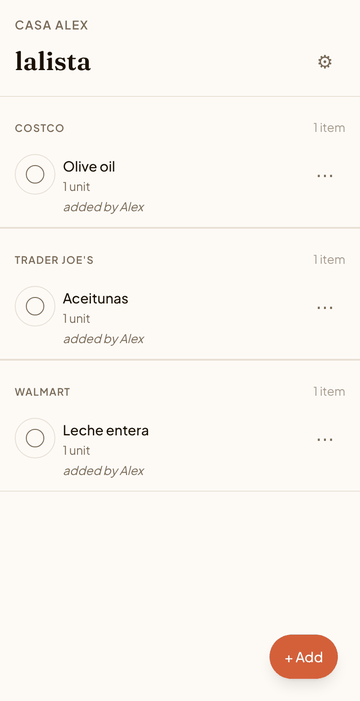

# lalista

> **Status: Work in progress** · last touched 2026-06

A grocery list for busy households, meant to take almost no time and keep you fully in control: say one word, and it knows what you mean and gets the cart ready for you to approve.

You're cooking for the kids and realize there's no mozzarella. The idea: press a button on your phone, say "mozzarella", done. No unlocking, no wading through notifications, no finding the app and typing a note. lalista should know that in your house "mozzarella" means the shredded one from Costco, file it there, and prepare the online cart so all you do is approve the purchase. Today only the first piece exists: a shared web list you type into, in English or Spanish, that remembers which store you buy each thing at, and it doesn't do that very well yet. Voice, knowing the exact product, and cart set-up are the goal, not features.

## Approach

Built with Claude Code agents, following a spec-first loop I've been developing alongside it (devshop). Each change starts as a written spec with acceptance criteria, and the spec gets an adversarial review. Then the agent builds code, tests and docs together, captures Playwright screenshots as evidence, and opens a PR that CI must pass. I chose what to build, approved specs, reviewed PRs and used the app with my household. Human in the loop: @meirmsn. Robot hands: @meirmsn-agent, which packaged this public snapshot; during development the agent committed under my account.

What the process taught: the first version was a native iOS app in Swift/SwiftUI that ran in the simulator, but the agent couldn't check its own work there. I shelved it for the web so the agent could verify every change itself in Playwright. Also, about half of the merged PRs went into the process and the dev environment rather than the product.

## What it does

- One list per household. When someone adds or buys an item, it shows up on everyone else's screen without a refresh.
- Type item names in English or Spanish: "leche", "aceitunas", "shredded mozzarella".
- Learns where you shop. Items you've bought before go under that store automatically; otherwise it asks which store.
- "Which one?" when a word matches several products, with an "add as new" option when none of them fit.
- Invite family with a link. Owners can remove members, and an activity log shows who did what.
- Your own list of stores, including ones we don't list. Installs to your phone's home screen.

## How it works

- Next.js web app on Cloudflare Workers (built with OpenNext), with Supabase for Postgres, auth, realtime updates and an edge function. A Turborepo monorepo with shared `core` (API) and `ui` packages.
- Adding an item runs one edge function. It fuzzy-matches the text against the item catalog with Postgres trigram similarity. If the text contains common Spanish words, Claude also translates it to English in parallel, and whichever match scores higher wins. Several close matches mean a "Which one?" question.
- The store comes from a SQL function that ranks stores by the household's purchases over the last six months, weighting recent ones more. When one store holds at least 70% of that weighted history, the item is filed silently; otherwise the app asks. Purchase history is written only by "mark bought" (one atomic database call).
- Households are isolated with Postgres row-level security. Key rules live in the database, not just the app: one household per account for now, and list items only for stores in the household's list.
- Web over native: the Swift/SwiftUI iOS app with a Siri shortcut is kept in [`ios-archive/`](ios-archive/), and the web app replaced it.
- Tests: Vitest unit tests, integration tests, and Playwright end-to-end tests at phone and desktop sizes. Every page has an end-to-end test; in development, CI ran them against a local Supabase.

## Build log

- 2026-04-16 — First commit: the Swift/SwiftUI iOS app (built before this history began) and the start of a web version.
- 2026-04-17 — Web rewrite begins; the iOS app is archived.
- 2026-04-20 — Sign-in and household set-up.
- 2026-04-22 — The core loop on the web: list grouped by store, add an item, "Which one?", item detail, mark bought.
- 2026-04-23 — "Add as new" when nothing in the catalog fits.
- 2026-05-05 — Reworked sign-up and password reset; moved to lalista.store.
- 2026-05-06 — Instant visual feedback on taps and slow loads.
- 2026-05-08 — Fixes for the installed app on iPhone (input zoom, standalone mode).
- 2026-05-11 — Invite links, member management and an activity log.
- 2026-05-12 — My Stores (per-household store list, custom stores). Also a fix for a false "sync paused" banner when the phone wakes.
- 2026-05-13 — Last product change. Since then the only commits have been to the dev environment. Next up: voice capture, a native app, cart set-up.

## Known limitations

- No voice input yet: you type. Your phone keyboard's dictation works, but the app doesn't listen.
- Type the item, not a sentence: "mozzarella" works, "we ran out of mozzarella" doesn't.
- It infers the store, not the product. "leche" always asks which milk, and brands aren't remembered.
- A new household has no history, so every item asks "which store?" until things have been marked bought.
- Spanish works best for words in the item list. Short words can match unrelated items (e.g. "papas" also offers "Pasta de dientes").
- Items can't be edited after adding: remove the item and add it again.
- Web only. One household per account; English and Spanish only. No online ordering or cart set-up.

## Run it

- **Use it:** [lalista.store](https://lalista.store). Sign up with an email address.
- **Locally:** needs Node 22, pnpm 10, Docker and the [Supabase CLI](https://supabase.com/docs/guides/cli).
  1. `pnpm install`
  2. `supabase start` (applies the migrations and the demo seed)
  3. In `apps/web/.env.local`, set `NEXT_PUBLIC_SUPABASE_URL=http://127.0.0.1:54321` and `NEXT_PUBLIC_SUPABASE_ANON_KEY` to the anon key printed by `supabase status`.
  4. `pnpm --filter @lalista/web dev`, then sign in at http://localhost:3000 as `alice@test.local` / `Password123!`.
- Optional: to have Claude translate Spanish phrases, put `ANTHROPIC_API_KEY=…` in `supabase/functions/.env` and restart Supabase. Developer notes: [`docs/DEVELOPMENT.md`](docs/DEVELOPMENT.md).

## Feedback

Suggestions and critiques welcome — open an issue or a discussion.

## License

[MIT](LICENSE)
